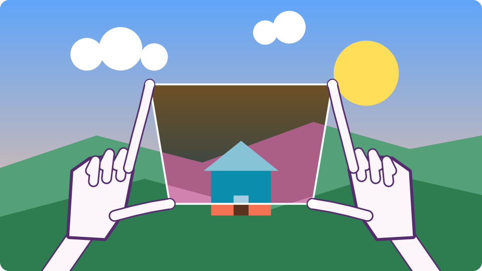
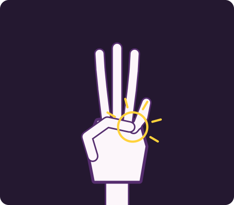
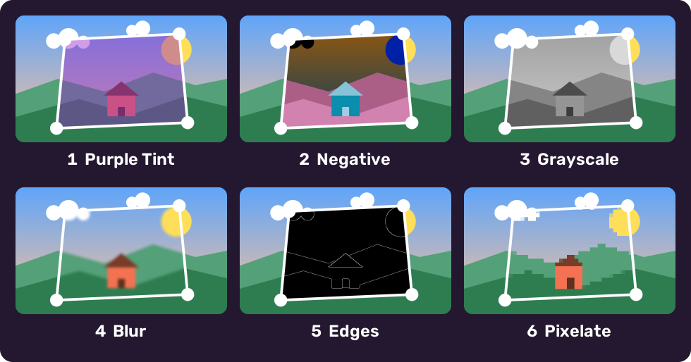

<p align="center">
  
</p>

<p align="center">
  
</p>

<p align="center">
  Hold up both hands in front of your webcam like a picture frame.<br>
  Everything inside the frame gets a filter. Everything outside stays normal.<br>
  <b>Free. Works on Windows and Mac.</b>
</p>

---

## 📥 Install on Windows

1. **Get Python** (free): go to [python.org/downloads](https://www.python.org/downloads/),
   download it and run the installer. If you see a box called
   **"Add python.exe to PATH"**, tick it.
2. **Get Filter Portal**: at the top of this page, click the green
   **Code** button, then **Download ZIP**. Open the downloaded file and
   click **Extract all**.
3. **Start it**: open the extracted folder (if there's another folder
   inside, open that too) and double-click **`Filter Portal.bat`**.
   - If Windows shows a warning, click **More info**, then **Run anyway**
     (or just **Run**).
   - The first time, it sets itself up. This takes a few minutes. After
     that it starts right away.

## 📥 Install on Mac

1. **Get Python** (free): go to [python.org/downloads](https://www.python.org/downloads/),
   download it and run the installer.
2. **Get Filter Portal**: at the top of this page, click the green
   **Code** button, then **Download ZIP**. Open the downloaded file.
   You now have a folder called **`filter-portal-main`** in Downloads.
3. **Start it**: open the **Terminal** app (press <kbd>Cmd</kbd>+<kbd>Space</kbd>,
   type `Terminal`, press <kbd>Enter</kbd>). Copy this line, paste it into
   Terminal and press <kbd>Enter</kbd>:

   ```bash
   cd ~/Downloads/filter-portal-main && python3 -m venv .venv && .venv/bin/pip install -r requirements.txt && .venv/bin/python filter_portal.py
   ```

   The first time takes a few minutes. If your Mac asks whether Terminal
   may use the camera or open files in Downloads, click **Allow** (or **OK**).
4. **Next time**, paste this shorter line instead:

   ```bash
   cd ~/Downloads/filter-portal-main && .venv/bin/python filter_portal.py
   ```

<details>
<summary>Want a Filter Portal icon in your Dock instead of using Terminal?</summary>

<br>

Paste these two lines into Terminal, one at a time. The first one installs
Apple's free developer tools (click **Install** when asked, it takes a few
minutes). The second one builds the app and puts it in your Dock.

```bash
xcode-select --install
```

```bash
cd ~/Downloads/filter-portal-main && .venv/bin/python build_app.py
```

After that, just click **Filter Portal** in the Dock. The first time, click
**Allow** when it asks to use the camera. Keep the `filter-portal-main`
folder where it is: the app runs from there.

</details>

---

## 🖐️ How to use



| Do this | What happens |
|---|---|
| Hold up both hands like a frame: **pointer fingers on top, thumbs at the bottom** | The portal opens |
| **Touch your thumb to your pinky** (either hand) | Next filter |
| Press <kbd>1</kbd> to <kbd>6</kbd> | Pick a filter |
| Press <kbd>S</kbd> | Save a picture (it goes to **Pictures › Filter Portal**) |
| Press <kbd>H</kbd> | Hide the text on the screen |
| Press <kbd>Q</kbd> | Quit |

**Tip:** twist one hand so its thumb is on top, and the frame crosses into an X.

<br clear="right">

## 🎨 The 6 filters

<p align="center">
  
</p>

---

## 🛟 Something not working?

**"Could not open the webcam"**
Close other apps that use the camera (Zoom, Teams, FaceTime...). Then check
the camera is allowed:
- **Windows:** Settings › Privacy & security › Camera. Turn on
  **Camera access** and **Let desktop apps access your camera**.
- **Mac:** System Settings › Privacy & Security › Camera. Turn on
  **Terminal** (or **Filter Portal** if you made the Dock app).

**No frame appears**
Show **both** hands fully, not too close to the camera, in good light. The
text on screen says how many hands it can see.

**Touching thumb to pinky doesn't change the filter**
Hold the touch for a moment, then let go before the next one. Press
<kbd>D</kbd> to see how sure the app is that you're touching. You can also
press <kbd>1</kbd> to <kbd>6</kbd> instead.

**Windows says "Python was not found"**
Install Python again from [python.org](https://www.python.org/downloads/)
and tick **"Add python.exe to PATH"** if the installer shows it.

---

<details>
<summary><b>For developers</b>: how it works, training the gesture model, tests</summary>

<br>

[](https://github.com/aarseniii/filter-portal/actions/workflows/tests.yml)

### How it works

[MediaPipe](https://ai.google.dev/edge/mediapipe) finds 21 points on each
hand. The tips of both pointer fingers and both thumbs become the corners of
the portal (smoothed so it doesn't jitter), and [OpenCV](https://opencv.org)
applies the filter only inside that shape. The thumb-to-pinky switch is a
small neural network that looks at each hand's 21 points; it runs with plain
numpy. Settings like smoothing, filter strength and gesture sensitivity are
at the top of `filter_portal.py`.

### Run from source

```bash
git clone https://github.com/aarseniii/filter-portal.git
cd filter-portal
python3 -m venv .venv
.venv/bin/pip install -r requirements.txt     # Windows: .venv\Scripts\pip
.venv/bin/python filter_portal.py             # Windows: .venv\Scripts\python
```

On Linux, OpenCV and MediaPipe also need `libgl1 libegl1 libgles2`
(Ubuntu/Debian: `sudo apt install libgl1 libegl1 libgles2`).

### The gesture model

`pinky_thumb_model.npz` was trained by `train_gesture_model.py` on hand
landmarks from [HaGRIDv2](https://github.com/hukenovs/hagrid) (about a
million hands). HaGRID only shows the touch with three fingers up, so
training adds made-up touches built from real hands in every other pose,
including the frame pose. On HaGRID's held-out test set (people not seen in
training) it recognises 99.7% of real touches and 99.8% of made-up touches
from the frame pose, and wrongly fires on 0.06% of other hand poses.

```bash
.venv/bin/pip install -r requirements-train.txt
.venv/bin/python train_gesture_model.py      # downloads ~720 MB the first time
```

To teach it your own hand, record about a minute of examples first (only
hand point positions are saved, never images): run
`.venv/bin/python record_my_gesture.py`, press <kbd>T</kbd> while touching,
<kbd>N</kbd> for anything else, <kbd>S</kbd> to save, then train again.

### Tests

None of the tests use the webcam or open windows. GitHub runs them on
Windows, macOS and Linux after every push.

```bash
.venv/bin/python -m unittest discover tests -v
bash tests/test_app_launcher.sh               # Mac only: the Dock app's launcher
```

### Files

| File | What it is |
|---|---|
| `filter_portal.py` | The app |
| `Filter Portal.bat` | Windows: double-click to set up and start |
| `build_app.py` | Mac: builds the Dock app (needs Xcode command line tools) |
| `train_gesture_model.py` | Trains the thumb-to-pinky model |
| `record_my_gesture.py` | Records your own gesture examples |
| `pinky_thumb_model.npz` | The trained model |
| `docs/` | The pictures on this page (`docs/make_pictures.py` draws them) |
| `tests/` | Tests |

</details>

## 📄 License

The code is free to use under the [MIT License](LICENSE). The gesture model
and the sample hand data in `tests/` come from
[HaGRIDv2](https://github.com/hukenovs/hagrid) and stay under its license (a
variant of CC BY-SA 4.0). Hand tracking by Google MediaPipe.
